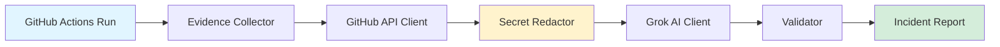

# Pipeline Doctor

**AI-powered GitHub Actions failure diagnosis** — Automatically analyzes workflow failures, identifies root causes, and proposes fixes with human oversight.

Pipeline Doctor is a standalone Python library that collects evidence from failed GitHub Actions runs, uses AI (Grok) to diagnose the issue, and generates comprehensive incident reports with proposed fixes. All analysis is evidence-based, security-conscious, and requires human approval before any changes are applied.

## What It Does

- ✅ **Collects Evidence**: Fetches workflow metadata, job logs, YAML configs, and source files
- ✅ **Diagnoses Failures**: Uses Grok AI to identify root causes and distinguish primary from cascading failures
- ✅ **Generates Reports**: Produces JSON Schema-compliant incident reports with confidence scores
- ✅ **Proposes Fixes**: Suggests patches with risk assessment (always requires human approval)
- ✅ **Security-First**: Automatic secret redaction before AI processing, read-only GitHub access
- ✅ **Validated Output**: Comprehensive Pydantic v2 models with cross-field validation

## What It Does NOT Do (Yet)

- ❌ Automatic PR creation with fixes
- ❌ GitHub App/webhook integration for auto-triggering
- ❌ Automatic execution of AI-generated commands
- ❌ Live monitoring or alerting

## Architecture



**Flow**: GitHub run metadata + logs → Redacted evidence → Grok diagnosis → Validated JSON report → Human review

## Quick Start

### 1. Install

```bash
python3 -m venv venv
source venv/bin/activate
pip install -e ".[dev]"
```

### 2. Set Environment Variables

```bash
export GITHUB_TOKEN="ghp_..."        # Fine-grained read-only token
export GROK_API_KEY="xai-..."        # xAI API key (or use --fake for testing)
```

### 3. Run Diagnosis

```bash
# Real diagnosis with Grok
python3 examples/diagnose_run.py owner/repo 12345

# Test with fake AI (no API key needed)
python3 examples/diagnose_run.py --fake owner/repo 12345
```

### 4. Run Tests

```bash
pytest
```

### 5. Validate Example Report

```bash
python3 -c "
import json
from pipeline_doctor.validator import IncidentReportValidator
report = json.load(open('examples/example-incident-report.json'))
result = IncidentReportValidator().validate(report)
print('✅ Valid!' if result.success else f'❌ Errors: {result.errors}')
"
```

## Status

| Component | Status | Notes |
|-----------|--------|-------|
| **GitHub Client** | ✅ Live | Real API client with read-only access; verified against public repos |
| **Evidence Collection** | ✅ Live | Workflow runs, job logs, YAML, source files; SHA pinning |
| **Secret Redaction** | ✅ Live | Patterns + high-entropy detection; known false positives on Docker image names |
| **Grok Client** | ⚠️ Mock-tested | NOT verified against live xAI API (account had no credits) |
| **Validation** | ✅ Live | Pydantic v2 + JSON Schema Draft 2020-12 |
| **CLI Example** | ✅ Live | Works with `--fake` flag; real Grok untested |
| **Log Download** | ✅ Live | Redirect + zip handling verified |
| **Model Name** | ⚠️ Unverified | Default `grok-beta` is unverified; check `/v1/models` for valid names |

**Verified Live**: Evidence collection and log download tested against real GitHub Actions runs.

**Not Verified Live**: Grok API integration has NOT been tested against the live xAI API due to lack of credits. All Grok tests use mocked HTTP responses.

## Documentation

- **[Getting Started](docs/getting-started.md)** — Installation, tests, running the CLI example
- **[Configuration](docs/configuration.md)** — All environment variables and constructor options
- **[GitHub Token Setup](docs/github-token.md)** — Creating a fine-grained read-only token
- **[xAI API Key Setup](docs/xai-api-key.md)** — Getting credits and choosing a model
- **[Usage Guide](docs/usage.md)** — Running diagnoses, reading reports, end-to-end walkthrough
- **[Troubleshooting](docs/troubleshooting.md)** — Common errors and fixes
- **[Security](docs/security.md)** — Read-only guarantee, redaction, prompt injection stance
- **[Incident Report Schema](docs/incident-report.md)** — Detailed schema documentation
- **[Roadmap](docs/roadmap.md)** — Remaining work and known issues

## License

No license file found in repository. See repository for license information.

## Contributing

See [CONTRIBUTING.md](CONTRIBUTING.md) for development setup and contribution guidelines.
